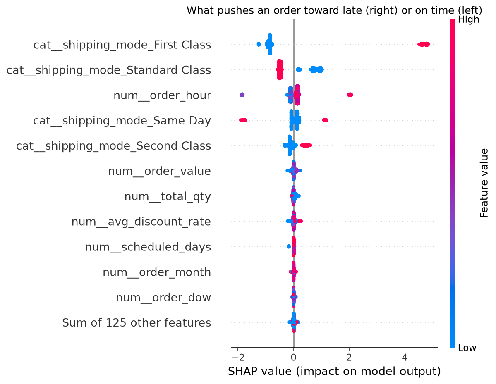
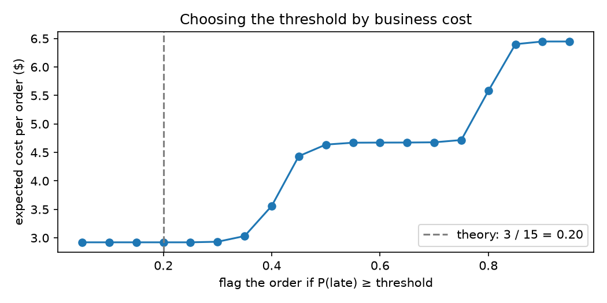

# Late Delivery Risk: an honest ML pipeline on real supply chain data

**Predict at checkout whether an order will ship late, without the data leaks that make most models on this dataset look perfect.**

Columns in this dataset that are only known after delivery let a model score 100% (this project's own cheating model does). With them removed, gradient boosting reaches **ROC-AUC 0.777**, and that is the ceiling: almost all predictable lateness comes from **two operational rules** the model found on its own. Fixing the delivery promises alone would cut the late rate from **57% to 16%**.



## Key findings

1. **Lateness is a promise problem.** First Class is promised in 1 day but always takes 2, so every First Class order is late. Second Class takes 2 to 6 days (equally likely) against a 2-day promise, so 80% are late.
2. **Second Class is no faster than Standard.** Both take 2 to 6 days with the same distribution; Second Class just promises less time.
3. **Same Day has a noon cutoff.** Orders placed before 12:00 arrive on time, orders after 12:00 arrive a day late, without exception.
4. **The rest is noise.** Within Standard and Second Class, no order detail (region, basket, payment, time) predicts lateness: ROC-AUC 0.505 and 0.494, a coin flip.
5. **Changing only the promises cuts the late rate from 57.3% to 15.9%,** with no change to operations:

| Change | Late rate |
|---|---:|
| Today | 57.3% |
| First Class promises 2 days | 42.0% |
| + Same Day orders after noon promised next-day | 39.4% |
| + Standard Class promises 5 days | 27.6% |
| + Second Class promises 5 days | **15.9%** |

## Results

Test set: the newest 20% of orders (12,580 orders, Jul 2017 to Jan 2018); models trained on the older 80% (50,317 orders, Jan 2015 to Jul 2017).

| Model | Accuracy (0.5 threshold) | ROC-AUC |
|---|---:|---:|
| Always predict "late" | 57.5% | 0.500 |
| Shipping-mode lookup (one `groupby`) | 69.5% | 0.744 |
| Logistic regression | 70.6% | 0.753 |
| Random forest | 72.5% | 0.775 |
| **Gradient boosting** (deployed) | 72.2% | **0.777** |
| Gradient boosting, tuned (20-trial random search) | 72.4% | 0.776 |
| Two hand-written rules, no ML | 72.5% | 0.776 |
| ❌ *Cheating: + actual shipping days* | *100%* | *1.000* |

- **The models hit the ceiling.** The two rules plus the transit-time table give a best possible accuracy of about 72%; tuning changed nothing (cross-validated AUC 0.7762 before and after).
- **Differences below 0.003 AUC are noise:** 5-fold time-series cross-validation varies by ±0.003 to ±0.005 between folds.
- **Why ship a model if two rules tie it?** Nobody hands you the rules: the model found both. If the cutoff moves, retraining picks it up; hand-written rules go stale. The rules stay as a benchmark the model must beat.

## Data leaks found and fixed

| Problem | Evidence | Fix |
|---|---|---|
| `Delivery Status` is the label | "Late delivery" is late 100% of the time | dropped |
| `Days for shipping (real)` is known only after delivery | late = real days > promised days, exactly | dropped |
| `Order Status`, shipping date change after ordering | | dropped |
| Canceled and suspected-fraud orders never shipped but are labeled "not late" | all 7,754 such rows are 0 | rows removed (late rate 54.8% → 57.3%) |
| One row per **item**, lateness is per **order** (2.75 items per order) | lateness never varies within an order | rebuilt as one row per order, so an order can't sit in both train and test |
| Random split would train on the future | | time-based split and `TimeSeriesSplit` cross-validation |

## Choosing the decision threshold by cost

The model outputs well-calibrated probabilities (Brier score 0.175 vs 0.245 for always predicting the average). Operations needs a yes/no, so the threshold comes from cost, not from 0.5:

- Flagging an order (proactive message or planner check): **$3** (assumed)
- A late order nobody flagged: **$15** (assumed)
- Flag when P(late) ≥ 3 / 15 = **0.20**



| Threshold | Cost per order | Late orders caught | Late orders missed | False alarms |
|---|---:|---:|---:|---:|
| Flag nothing | $8.62 | 0 | 7,227 | 0 |
| 0.5 (default) | $4.64 | 4,318 | 2,909 | 584 |
| **0.20 (cost-based)** | **$2.92** | **7,227** | **0** | 5,025 |

At 0.20 the model flags 97% of orders: every order except Same Day orders placed before noon. With 57% of orders late and a cheap flag, warning almost everyone is cheapest. That is why the real fix is the promises. (Accuracy at this threshold is 60.1%; it is lower on purpose, because the goal is cost.)

## How it works

```
raw file (180,519 item rows)
  → src/data.py     drop leaky columns, remove canceled/fraud rows, one row per order (62,897), time features
  → src/model.py    ColumnTransformer (one-hot + scaling) → gradient boosting, in one scikit-learn Pipeline
  → src/train.py    score on the newest 20%, retrain on all data, save model + threshold + metadata
  → src/api.py      FastAPI: validate the order (Pydantic), predict, flag at 0.20
```

**API example** (`uvicorn src.api:app`, then open http://127.0.0.1:8000/docs):

| Same Day order placed at | `late_probability` | `flag` |
|---|---:|---|
| 09:30 | 0.039 | false |
| 15:30 | 0.979 | true |

Invalid input, such as an unknown shipping mode, is rejected with HTTP 422 before it reaches the model.

## Run it

```bash
git clone https://github.com/iabdullah42/late-delivery-risk-ml.git
cd late-delivery-risk-ml
pip install -r requirements.txt
```

Download `DataCoSupplyChainDataset.csv` ([Mendeley Data](https://data.mendeley.com/datasets/8gx2fvg2k6/5) or [Kaggle](https://www.kaggle.com/datasets/shashwatwork/dataco-smart-supply-chain-for-big-data-analysis)) into `data/raw/`, then:

```bash
mkdir data/processed
python -c "from src.data import load_raw, build_orders, ORDERS_PATH; build_orders(load_raw()).to_csv(ORDERS_PATH, index=False)"
python -m src.train          # trains and saves models/late_risk.joblib
uvicorn src.api:app          # API at http://127.0.0.1:8000/docs
pytest -q                    # 12 tests
```

## Project structure

```
notebooks/
  01_explore.ipynb          what one row is, the leaks, late rate by shipping mode
  02_build_dataset.ipynb    one clean row per order, with checks
  03_baselines.ipynb        time split, dumb baselines, first Pipeline
  04_models.ipynb           cheating model, tree models, AUC within each mode, the noon rule, promise what-if
  05_cv_tuning.ipynb        TimeSeriesSplit cross-validation, random search, rules vs ML
  06_threshold.ipynb        calibration and cost-based threshold
  07_shap.ipynb             SHAP explanations, overall and for one order
src/        data.py · model.py · train.py · api.py
tests/      test_data.py · test_model.py · test_api.py
docs/       charts used in this README
```

**Tools:** Python, pandas, scikit-learn (Pipeline, ColumnTransformer, HistGradientBoosting, RandomForest, TimeSeriesSplit, RandomizedSearchCV, calibration), SHAP, FastAPI, Pydantic, pytest.

**Data:** DataCo Smart Supply Chain for Big Data Analysis, Constante, Silva and Pereira (2019), Mendeley Data, [doi:10.17632/8gx2fvg2k6.5](https://data.mendeley.com/datasets/8gx2fvg2k6/5). The raw file is not included in this repo.
